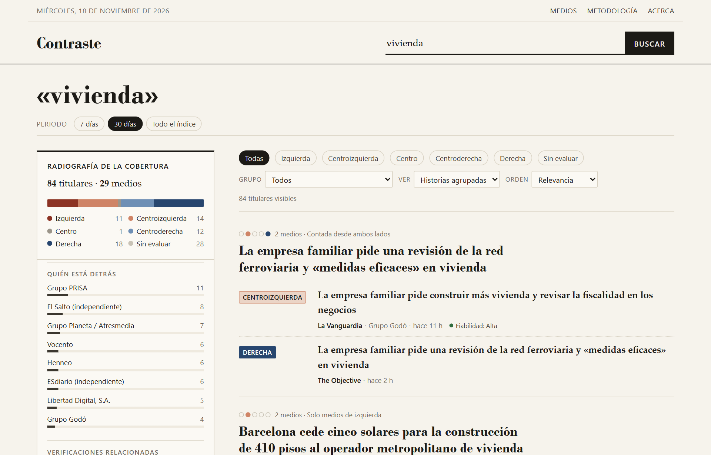
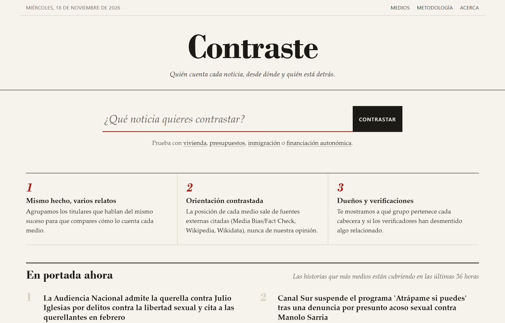
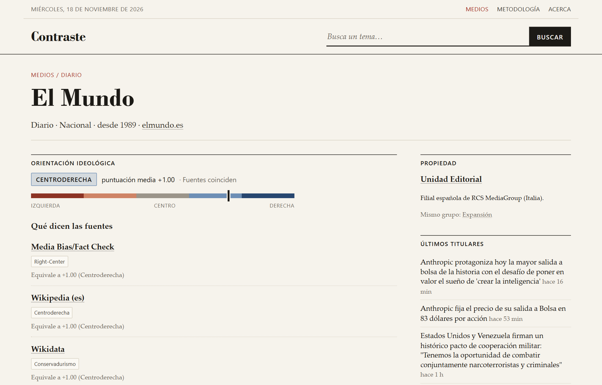

# Contraste

[](https://github.com/alfreedx/news-bias-analyzer/actions/workflows/ci.yml)
[](https://github.com/alfreedx/news-bias-analyzer/actions/workflows/verify-sources.yml)
[](LICENSE)
[](DATA_LICENSE.md)


**Busca una noticia y descubre quién la cuenta, desde qué orientación ideológica y quién es el dueño de cada medio.**

*A Spanish news search engine that shows, next to every headline, the outlet's political leaning (sourced from
Media Bias/Fact Check, Wikipedia and Wikidata), its factual reliability, who owns it, and related fact-checks.*



## Qué ofrece

| | |
|---|---|
| **Etiquetas citadas** | Lo que cada fuente dice del medio, con sus propias palabras («Wikipedia: Monarquismo, Catolicismo»), enlazado a la versión exacta consultada y con fecha. Nunca son adjetivos de Contraste. |
| **Orientación del medio** | Posición izquierda–derecha calculada **solo** a partir de fuentes externas citadas (Media Bias/Fact Check, Wikipedia, Wikidata). Sin fuentes, el medio aparece como «sin etiqueta publicada». |
| **Percepción del público** | Dónde sitúa la población a cada medio (encuesta del CIS, estudio 3511, mayo de 2025: media de 1 a 10, desviación típica y respuestas), mostrada aparte de las etiquetas. Solo da posición, con la marca «(CIS)», a los medios sin ninguna etiqueta. |
| **Fiabilidad factual** | Calificación de Media Bias/Fact Check y acreditación IFCN de los verificadores. |
| **Propiedad** | Grupo de comunicación de cada cabecera y quién está detrás de él. |
| **Historias agrupadas** | Los titulares de distintos medios sobre el mismo hecho, juntos, para comparar el enfoque. |
| **Quién la cuenta** | Reparto por posición (con el porcentaje «sin etiqueta» explícito), concentración por grupos y avisos cuando un lado apenas cubre el tema. |
| **En resumen** | En cada historia: qué coinciden en contar, qué cambia según el medio y qué han verificado Maldita, Newtral o EFE Verifica; con cronología y aviso de agrupación automática. |
| **Contenido patrocinado** | Solo cuando lo marca el propio medio (categoría RSS, sección de la URL o prefijo del titular) según reglas públicas en `data/sponsored_rules.json`: nota «Marcado como patrocinado por el medio», fuera de historias y recuentos, y aparte en las búsquedas. No detectar una marca no garantiza que una pieza no sea publicidad. |
| **Cómo leer** | Glosario `/como-leer` con los términos del sitio. |
| **Verificaciones** | Página `/verificaciones`: afirmaciones revisadas por Maldita.es, Newtral, EFE Verifica y Verificat, citadas tal como las publican (datos `ClaimReview` de su web). Una historia solo muestra una verificación si el verificador cita la dirección de una de sus noticias; nunca por palabras parecidas. Contraste no emite veredictos. |

Sin cookies, sin rastreadores, sin cuentas y sin coste.

<table>
  <tr>
    <td></td>
    <td></td>
  </tr>
</table>

---

## Cómo funciona

```
 RSS oficiales de ~75 medios ─┐
 + verificadores              ├─► ingesta cada 10 min ─► SQLite + FTS5 ─► FastAPI + Jinja2 ─► HTML sin JS obligatorio
 (defusedxml, 5 MB, 15 s)     ┘   (peticiones condicionales ETag)            │
                                                                             └─ data/media.json + data/groups.json
                                                                                (fuentes citadas, CC BY-SA)
```

| Pieza | Elección | Por qué |
|---|---|---|
| Backend | **FastAPI** | Ligero, tipado, fácil de desplegar gratis. |
| Búsqueda | **SQLite FTS5** | Búsqueda de texto completo sin servidor externo, insensible a tildes. |
| Noticias | **RSS oficiales** | Gratuito, legal y sin depender de las condiciones de Google News. |
| Catálogo | **JSON versionado** | Cada cambio queda auditado en Git con su fuente. Sustituye a Supabase. |
| Frontend | **Plantillas + CSS propio** | Sin dependencias de terceros, funciona sin JavaScript, CSP estricta. |

### Decisiones de diseño

- **Sin base de datos externa.** El catálogo de medios vive en `data/`, versionado y revisable, sin
  claves ni servicios que se pausen. El índice de noticias es un SQLite local que se reconstruye solo.
- **Sin opinión propia.** Ninguna posición se escribe a mano: se deriva de etiquetas publicadas por
  terceros mediante tablas públicas, y cada ficha enlaza sus fuentes.
- **Privacidad por defecto.** El navegador no contacta con ningún dominio distinto del propio sitio.

## Puesta en marcha

Requisitos: Python 3.11 o superior.

```bash
git clone https://github.com/alfreedx/news-bias-analyzer.git
cd news-bias-analyzer
python -m venv .venv
# Windows: .venv\Scripts\activate    ·   Linux/macOS: source .venv/bin/activate
pip install -r requirements.txt
cp .env.example .env                 # opcional: todos los valores tienen un valor por defecto
python -m app.cli ingest             # primera lectura de los feeds (~30 s)
uvicorn app.main:app --reload --no-access-log
```

Abre <http://localhost:8000>. La aplicación vuelve a leer los feeds cada 10 minutos mientras está encendida.

### Con Docker

```bash
docker build -t contraste .
docker run -d --name contraste -p 8000:8000 \
  -e ALLOWED_HOSTS=localhost,127.0.0.1 \
  -v contraste-data:/data --read-only --tmpfs /tmp \
  contraste
```

### Despliegue gratuito en Render

[](https://render.com/deploy?repo=https://github.com/alfreedx/news-bias-analyzer)

El repositorio incluye un [`render.yaml`](render.yaml) que crea un servicio web gratuito a partir del
`Dockerfile`, con HTTPS y cabeceras de seguridad. El job `deploy` de CI lanza el despliegue (Deploy Hook de Render, guardado como secreto `RENDER_DEPLOY_HOOK`) solo cuando pasan los tests, el e2e y la imagen Docker.
El nombre público que asigna Render (`RENDER_EXTERNAL_HOSTNAME`) se admite automáticamente.
El plan gratuito se suspende tras 15 minutos sin visitas: la primera visita tarda unos segundos.

**Historial entre reinicios.** El disco de Render gratuito es efímero: cada despliegue o reinicio borra
`var/news.sqlite3` y el índice volvería a tener solo lo que ofrecen ahora los RSS (1-2 días). Para conservar
los 120 días de historial sin servicios de terceros, el workflow
[`data-snapshot.yml`](.github/workflows/data-snapshot.yml) (cada 6 horas, a mano y justo antes de cada despliegue)
guarda una **instantánea cifrada** como asset de la release `data-snapshot`: `gzip` del SQLite cifrado con
Fernet (`cryptography`) **por bloques de 4 MB** (ni al crearla ni al restaurarla se carga el archivo entero en
memoria; el formato anterior, un único token, se sigue leyendo), sin firmas (autores) y limitada por `RETENTION_DAYS`. Cada ejecución parte de la
anterior, así que acumula historial aunque el servidor esté dormido. Para activarlo:

1. Genera una clave: `python -c "from cryptography.fernet import Fernet; print(Fernet.generate_key().decode())"`.
2. Guárdala como secreto de GitHub Actions `SNAPSHOT_KEY` (`gh secret set SNAPSHOT_KEY`) **y** como variable
   `SNAPSHOT_KEY` del servicio en Render (el `render.yaml` la declara con `sync: false`).
3. Lanza el workflow una vez (`gh workflow run data-snapshot.yml`); crea la release si no existe.

Al arrancar, si hay clave y el índice local tiene menos de 2000 titulares, la app descarga la instantánea
(`SNAPSHOT_URL`, derivada de `REPO_URL`; solo hosts de GitHub), la descifra, comprueba `PRAGMA integrity_check`
y las tablas esperadas y la mueve a su sitio de forma atómica. Si algo falla, avisa en el registro y sigue con
el índice local. Sin `SNAPSHOT_KEY` no se hace nada. Para probarlo en local:
`python scripts/snapshot.py build --out var/s.enc` y `python scripts/snapshot.py restore --url var/s.enc --to var/x.sqlite3`.

### Otros servicios

Cualquier servicio que ejecute un contenedor Docker sirve (por ejemplo, Hugging Face Spaces o Render
en su plan gratuito en el momento de escribir esto). Si el disco del servicio es efímero no pasa nada:
el índice se reconstruye solo al arrancar (o se restaura de la instantánea cifrada descrita arriba).

En producción configura como mínimo:

| Variable | Valor |
|---|---|
| `ALLOWED_HOSTS` | Tu dominio, p. ej. `contraste.example.org` |
| `HTTPS_ONLY` | `true` (activa HSTS) |
| `TRUST_PROXY_HEADERS` | `true` solo si hay un proxy de confianza delante |
| `SITE_URL`, `REPO_URL` | URLs públicas |

Mantén `GOOGLE_NEWS_ENABLED=false` en una instancia pública: las condiciones del RSS de Google News
solo permiten uso personal y no comercial.

## Estructura

```
app/
  main.py        rutas, ingesta en segundo plano, ayudas de plantilla
  catalog.py     carga y valida data/*.json, asocia URLs a medios
  scoring.py     tablas públicas etiqueta → posición (la «metodología» en código)
  analysis.py    agrupación de historias, cobertura, noticias que cuenta sobre todo un lado
  feeds.py       descarga y análisis seguro de RSS/Atom (concurrencia configurable, máx. 2 peticiones por servidor)
  status.py      datos de la página pública /estado
  sponsored.py   reglas públicas de contenido patrocinado marcado por el medio
  db.py          SQLite + FTS5, consultas parametrizadas
  security.py    cabeceras de seguridad y limitador de peticiones
  templates/     HTML (Jinja2)   ·   static/  CSS, JS e icono
data/            catálogo de medios y grupos y propiedad citada, `ownership.json` (CC BY-SA 4.0), y percepción del público del CIS, `perception.json` (CC BY 4.0)
scripts/         verify_sources.py: comprueba fuentes y calificaciones; sponsored_survey.py: mide las marcas de patrocinio de los RSS;
                 discover_media.py: descubre medios candidatos (Wikidata + feeds) y los da de alta con --apply
tests/           pytest
```

## API

| Ruta | Descripción |
|---|---|
| `GET /api/buscar?q=texto&dias=7\|30\|todo` | Historias, cobertura y verificaciones en JSON |
| `GET /api/medios` | Catálogo completo con evaluaciones y propiedad citada (`ownership_facts`: texto, fuente y fecha de cada dato) |
| `GET /api/salud` | Estado del servicio |
| `GET /estado` | Página pública: feeds activos, con fallos y en pausa, última lectura y tamaño del índice (sin IP ni datos de visitantes) |

### Descubrimiento de medios

`python scripts/discover_media.py` busca en Wikidata periódicos, emisoras, agencias y webs de noticias de España
con web oficial, descubre su feed (`<link rel="alternate">` y rutas habituales, respetando `robots.txt`, máximo 3
peticiones por sitio) y aplica la misma puerta de entrada que el catálogo. Escribe `data/candidates.json`
(informe completo con motivos) y `data/media.candidates.json` (entradas listas para fusionar); nunca toca
`data/media.json`. El workflow semanal [`discover-media.yml`](.github/workflows/discover-media.yml) abre un pull
request con los que pasan; el alta es manual con `--apply` (ver [CONTRIBUTING.md](CONTRIBUTING.md)).

Los feeds que fallan 20 veces seguidas se dejan de consultar 24 horas (duplicando la pausa en cada nuevo fallo, hasta
7 días). `INGEST_CONCURRENCY` (por defecto 8) limita las peticiones simultáneas.

## Calidad y seguridad

```bash
pip install -r requirements-dev.txt
ruff check app tests scripts
python -m pytest
pip-audit -r requirements.txt
python -m pytest -m e2e             # pruebas en navegador con Playwright (python -m playwright install chromium)
python scripts/verify_sources.py    # ¿siguen vivas las fuentes? ¿ha cambiado alguna calificación o ficha?
```

Las medidas de seguridad y privacidad están detalladas en [SECURITY.md](SECURITY.md) y en la página
`/privacidad` de la propia web.

## Limitaciones conocidas

- Solo aparecen en los resultados los medios con RSS accesible; algunos (SER, Público…)
  lo bloquean o no lo publican. Están en el catálogo pero no en el índice.
- El índice empieza vacío y guarda 120 días: las búsquedas sobre temas antiguos no darán resultados.
- La agrupación de historias es una heurística sencilla.
- Hay medios sin evaluación externa publicada; se muestran como «sin etiqueta publicada» en lugar de inventar una posición.
- Las etiquetas de Wikipedia rara vez citan su propia fuente. Por eso se fijan a una revisión concreta y el CI semanal avisa si cambian.

## Licencias

- **Código**: [MIT](LICENSE).
- **Datos** (`data/`): [CC BY-SA 4.0](DATA_LICENSE.md), por incluir información adaptada de Wikipedia.
- **Tipografía**: Newsreader, SIL Open Font License 1.1. Ver [THIRD_PARTY_NOTICES.md](THIRD_PARTY_NOTICES.md).
- Los titulares y marcas pertenecen a sus medios; la aplicación solo muestra titular, extracto y enlace.
- Las calificaciones de Media Bias/Fact Check pertenecen a MBFC y se citan con enlace a la reseña original.

## Hoja de ruta

El plan para cubrir todos los medios españoles que publican de forma abierta, manteniendo el proyecto gratuito, seguro, privado y sostenible, está en [`docs/PLAN-COBERTURA.md`](docs/PLAN-COBERTURA.md).

## Contribuir

Las correcciones de datos son especialmente bienvenidas. Si representas a un medio, consulta la [política de rectificación](RECTIFICATION.md). Lee [CONTRIBUTING.md](CONTRIBUTING.md) y el
[código de conducta](CODE_OF_CONDUCT.md). Para vulnerabilidades, consulta [SECURITY.md](SECURITY.md).
